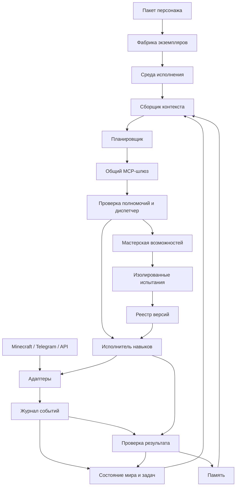

# Архитектура

Статус: предлагаемая архитектура, реализация отсутствует.

## Компоненты



## Постоянный runtime

Экземпляр персонажа существует независимо от engine session. Core хранит длительные обязанности, wakeups, ожидания и политику уведомлений. Scheduler запускает решения по событиям и срокам, включая периоды между разговорами. [Модель по образцу Dots](persistent-agents.md).

## Движок агента

Планировщик реализуется через адаптер Pi Agent или Codex. Движок ведёт агентный turn и его tool loop; внешний харнес управляет жизненным циклом персонажа, событиями, долговременной памятью, целями, быстрыми реакциями и полномочиями. Подробности: [движки](engines.md). Собственный параллельный LLM tool loop не создаётся.

## MCP-интерфейс

Minecraft, Telegram, память и мастерская публикуются через [общий MCP-шлюз](mcp-gateway.md). Движок не обходит gateway при действиях в средах. События мира продолжают поступать в core через журнал; MCP не заменяет цикл пробуждения персонажа.

## Три уровня управления

- Быстрые реакции: локальные правила для остановки, опасности и отмены действий; не ждут LLM.
- Навыки: процедуры, конечные автоматы или деревья поведения с прогрессом и обратной связью.
- Стратегия: LLM выбирает цели и ближайшие исполнимые шаги по существенным событиям.

Модель не управляет каждым игровым тиком. В состоянии ожидания харнес не вызывает её без причины.

## Контракты

Предлагаемый интерфейс адаптера:

```text
observe(cursor) -> events, next_cursor
capabilities() -> action_schemas
execute(action) -> operation_id
cancel(operation_id) -> cancellation_status
reconcile(operation_id) -> observed_status
health() -> connection_status
```

Событие содержит идентификатор, среду, источник, время наблюдения, версию состояния, уровень доверия и ссылку на исходные данные. Действие содержит идентификатор, цель, параметры, предусловия, дедлайн, полномочия и ожидаемый результат.

Задача содержит статус, приоритет, бюджет, зависимости, текущий шаг и проверяемые критерии завершения. Статусы: ready, running, waiting, blocked, completed, failed, cancelled.

## Конкурентность и восстановление

Конфликтующие действия получают блокировку ресурса: движением одного персонажа управляет один исполнитель. Независимые задачи могут выполняться параллельно. Опасность прерывает обычные навыки.

Намерение выполнить действие записывается до отправки. Входящие события дедуплицируются. Контрольные точки сохраняются вне контекста модели. После сбоя операции сверяются с внешней средой.

Для действий предусмотрен статус unknown: операция могла выполниться при потере ответа. Повтор допускается только с учётом контракта адаптера. Универсальная гарантия исполнения ровно один раз не предполагается.

## Полномочия

Политика исполнения находится вне LLM и описания личности. Внешний текст является данными, а не источником полномочий. Секреты доступны адаптерам, но не включаются в контекст. Новые инструменты не могут расширять права своего создателя.

## Предлагаемый стек

TypeScript для ядра и навыков; отдельный процесс Mineflayer для Minecraft; Bot API для Telegram; PostgreSQL для задач, журнала и памяти; полнотекстовый и векторный поиск; файловое или объектное хранилище для крупных артефактов. Стек первой версии зафиксирован в [отдельном документе](technology-stack.md); Pi SDK — первый движок.

## Источники интерфейсов

- https://github.com/PrismarineJS/mineflayer
- https://github.com/PrismarineJS/mineflayer-pathfinder
- https://core.telegram.org/bots/api
- https://core.telegram.org/api
