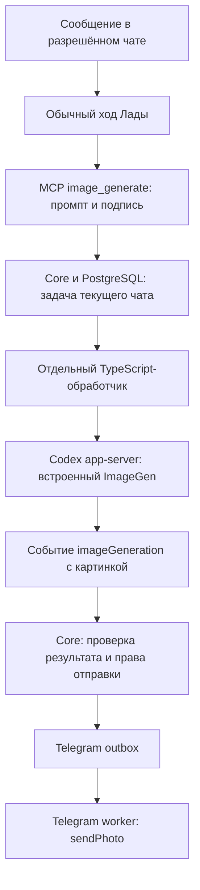
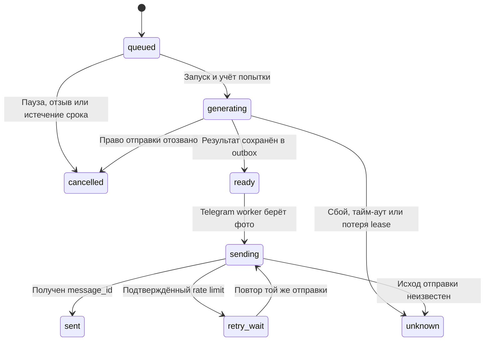

# Генерация картинок Ладой в Telegram

Дата: 2026-10-17. Подход: SDD. Спецификация согласована пользователем.
Уточнение пользователя: жёсткий контроль каждого вызова генератора сейчас не приоритет.
Текущий срез использует существующий TypeScript app-server и штатный ImageGen Codex;
Rust-адаптер и отдельный Images API не требуются.

## Поведение

Лада сама решает, когда ответить картинкой в разрешённой личке или группе.
Команда `/image` и подтверждение каждого рисунка не нужны. Промпт составляет сама
Лада по своей персоне и текущему чату. Её выбор может быть спонтанным ответом на
обычное сообщение, в том числе от другого участника группы.

После принятия задачи она может сообщить, что рисует. Результат отправляется
отдельным фото с подписью в тот же чат, с reply на исходное сообщение.
Лада не утверждает, что картинка уже готова или доставлена, по одному факту постановки
задачи. Установка аватарки бота остаётся ручным действием владельца.

## Технический путь

Всё работает в существующем Compose `character-harness`. В контейнере codex-engine
идёт отдельный асинхронный цикл и отдельный app-server-процесс для картинок. Основной
разговорный цикл не ждёт рисунка и может обрабатывать текстовые ответы дальше.

Обычный ход получает инструменты `image_generate` и `image_generation_status`.
Для него встроенная генерация явно выключена в конфигурации harness. Выделенный
процесс включает её и проводит один модельный ход с инструкцией вызвать генератор
ровно один раз. Прямой RPC-метод исполнения ImageGen не нужен: результат приходит
через штатное событие `item/completed` с `type: imageGeneration`.

## Частота и ограничения первой версии

| Ограничение | Значение |
| --- | --- |
| Запуски задач за скользящие 24 часа | 3 на всю Ладу |
| Запуски задач за календарный месяц UTC | 15 на всю Ладу |
| Одновременно ожидаемые/выполняемые задачи | 1 на всю Ладу |
| Задачи на исходное событие | 1 |
| Промпт / подпись | До 1500 / 500 символов |
| Начало задачи после постановки | Не позже 5 минут |
| Модельный ход с генерацией | До 3 минут |
| Максимальный файл | 10 MiB, PNG/JPEG |
| Доставка готового фото | В течение 5 минут после получения результата |

Сервер атомарно ограничивает **запуски задач**, сохраняет счётчики в PostgreSQL и
передаёт модели инструкции беречь бюджет. Начатые задачи учитываются и при ошибке,
неопределённом исходе или отмене результата. Повторная обработка одного события не
создаёт новую задачу.

Это **не жёсткий лимит фактических внутренних вызовов ImageGen**: выделенный
модельный ход теоретически может нарушить инструкцию об одном вызове. Подсчёт задач
не является гарантией стоимости или точного расхода подписки. Пользователь явно
снизил приоритет строгого контроля; такая гарантия не заявляется.

Изображения генерируются через существующий вход ChatGPT и расходуют лимиты Codex.
Платный API fallback не используется. Размер и качество выбираются штатным
инструментом; квадратный формат — инструкция, а не гарантированный параметр.
Эксперименты разработчика вне очереди не включаются автоматически в её счётчики.

## Состояния и доставка

`ready` — состояние image job: картинка принята core и находится в outbox.
Отдельное поле `delivery_state` показывает фактический исход Telegram-доставки.
Генерация при ошибке не повторяется автоматически. Потерянная выполняющаяся задача
становится `unknown`, а не запускается снова после рестарта.

Для подтверждённого Telegram rate limit можно повторить отправку того же файла;
рисунок заново не генерируется. Неопределённый исход отправки не вызывает
автоматического дубля. Существующий owner resolve остаётся способом ручного разбора.

Фото является продолжением ответа на исходное событие: если текстовый ответ
этого события уже допущен в outbox, картинка не подавляется повторно его же
минутным cooldown инициативы. Остальные ограничения доставки и пауза сохраняются.

## Изоляция и отзыв

Core получает character, audience, binding и revision из активного события.
Модель не выбирает адресата. Промпт содержит только нужный визуальный контекст
текущего чата; история других аудиторий, секреты и авторизация в него не передаются.
Редактирование входных картинок, произвольные локальные пути и URL не входят в срез.

Перед принятием результата и перед отправкой повторно проверяются пауза,
разрешённость binding и его revision. Отозванный результат не отправляется.
Внешнюю генерацию, которая уже началась, нельзя гарантированно отменить;
её расход не возвращается. Уже принятую Telegram отправку также нельзя отозвать.

Base64, формат и размер проверяются перед записью в outbox; для PNG проверяются
размеры заголовка до 4096 пикселей по каждой стороне. Это проверка оболочки файла,
а не полный декодер изображения. В обычные логи не попадают промпт, переписка,
авторизация и байты картинки.

## Настройка и наблюдаемость

`TELEGRAM_IMAGES_ENABLED=true` задаётся core и codex-engine. По умолчанию возможность
выключена. При выключении инструмент постановки задачи не публикуется и обработчик
картинок не запускается. Миграция `011-telegram-images` добавляет задачи и фото в outbox.

`GET /owner/images` показывает счётчики, задачи и состояние доставки.
`image_generation_status` показывает Ладе общий счётчик и только задачи её чата.
Логи содержат старт/исход задачи, старт Telegram worker, размер входящей пачки и
исход доставки с типом text/photo — без содержимого сообщений.

## Приёмка и проверка

- Самостоятельный выбор картинки не требует команды или отдельного подтверждения.
- Долгая генерация не занимает lease обычного разговора.
- Повтор события, завершения или получения результата не создаёт вторую задачу/фото.
- Пауза и отключение чата запрещают новую отправку; попытка остаётся учтённой.
- Рестарт не перезапускает потерянную генерацию.
- Проверены multipart sendPhoto, reply-параметры, сохранение неопределённого исхода,
  счётчики запусков, изоляция, конкурирующие claim и RPC-сообщения больше 2 MB.
- Настоящий TypeScript smoke получил native ImageGen-картинку размером 2 760 779 байт
  через существующую авторизацию. Тестовый результат сохранён локально, без отправки
  сообщений в Telegram. Rust и отдельный API-ключ не использовались.

Официальное описание встроенной генерации:
[OpenAI](https://learn.chatgpt.com/docs/image-generation).
