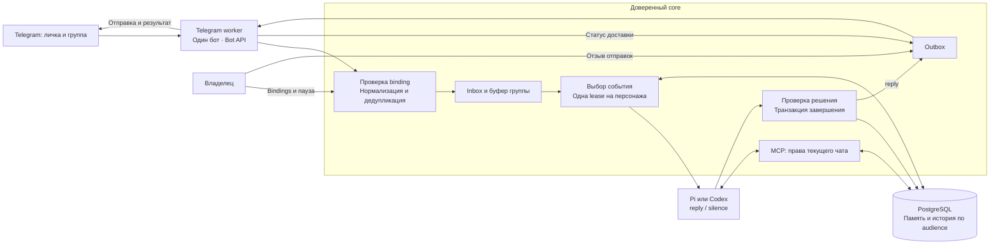
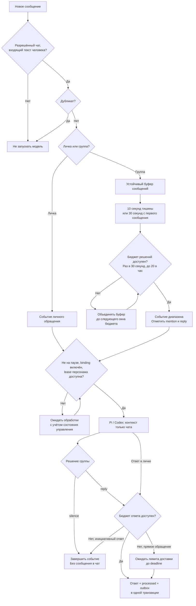
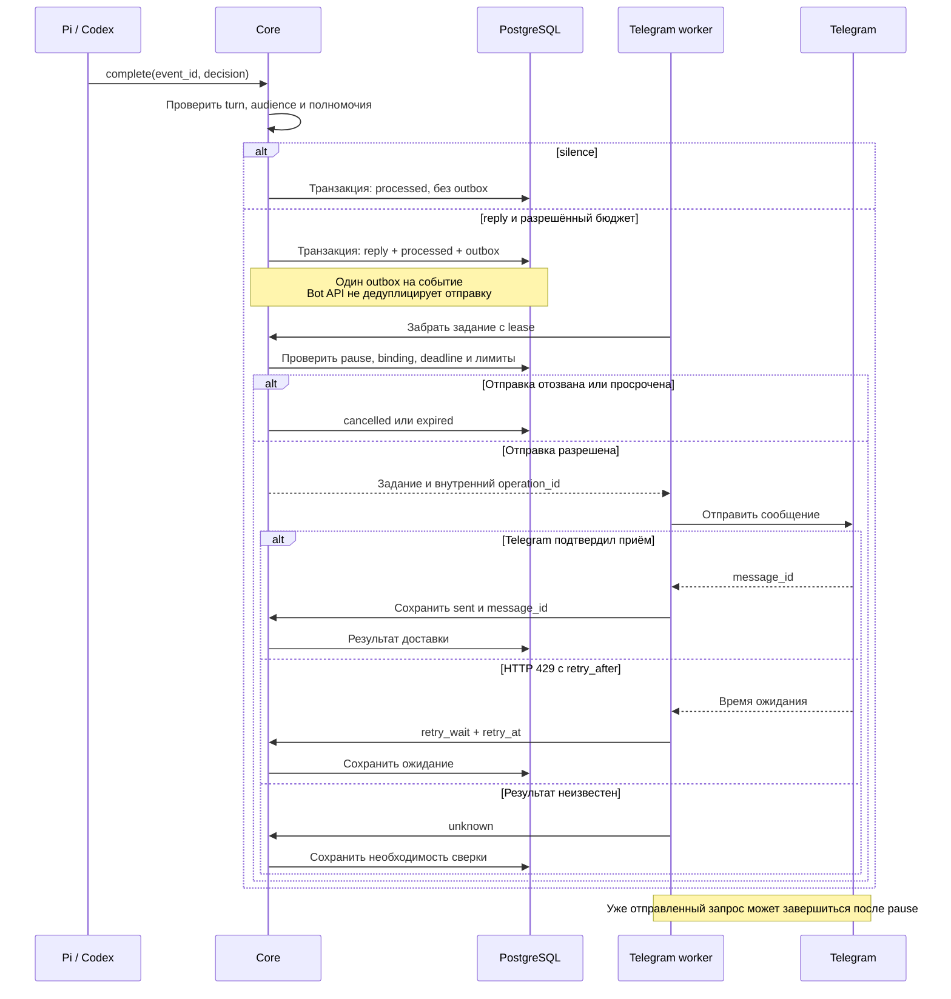
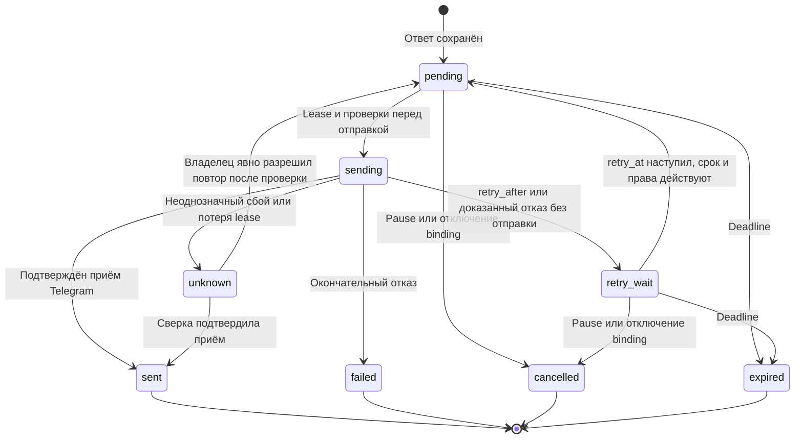

# Telegram MVP: диалоги постоянного персонажа

Дата: 2026-10-17. Статус: согласована пользователем 2026-10-17, реализована и проверена локально; живой smoke исходного MVP подтверждён.
Подход: Spec-Driven Development (SDD). Сначала согласуются наблюдаемое поведение и
критерии приёмки, затем технический план и реализация с проверками по этой спецификации.

## Цель и пользовательские сценарии

Лада общается через отдельного Telegram-бота (Bot API), сохраняет характер
и память внутри конкретного диалога. Используется существующий Pi или Codex engine.
Владелец явно подключает чаты и может остановить ответы.

Подтверждённый объём: разрешённая личка и одна тестовая группа. В личке
Лада отвечает на входящий текст. В группе она сама решает, вступать ли в разговор,
в том числе без упоминания. Приведённые ниже численные бюджеты — предложения
спецификации, пока не проверенные на живой переписке.

1. Владелец создаёт бота в BotFather, сохраняет token и подключает личный чат.
   Собеседник первым пишет боту. Для группы Privacy Mode отключается; после изменения
   бот повторно добавляется в тестовую группу. Права администратора не требуются.
2. Собеседник пишет Ладе, получает ответ в том же чате с reply на исходное сообщение.
3. В группе идёт разговор; Лада наблюдает его и выбирает ответить или промолчать.
   Прямое обращение отмечается в контексте как приоритетное, но не обходит паузу и бюджеты.
4. После перезапуска повторно доставленное событие не вызывает второй ответ.
5. Владелец ставит Ладу на паузу; новые внешние отправки прекращаются.

## Возможности и границы

| Возможность | Первый срез | Следующие срезы |
| --- | --- | --- |
| Текстовые ответы в разрешённых личках и группах | Да | — |
| Память и ограниченный контекст текущего чата | Да | — |
| Чтение доступной истории через MCP | Да, в пределах binding | — |
| Проверка доставки и состояния подключения | Да | — |
| Команды и callback-кнопки сторонних ботов | Нет | Отдельная спецификация |
| Файлы, голосовые сообщения и транскрипция | Нет | Отдельный срез |
| Вступление в текущий групповой разговор без упоминания | Да, с бюджетом и правом промолчать | — |
| Начало разговора по таймеру и напоминания | Нет | После scheduler и бюджетов инициативы |
| Редактирование, удаление и пересылка сообщений агентом | Нет | Отдельный срез |
| Связь личности с Minecraft и перенос памяти между чатами | Нет | Только явная привязка владельцем |
| Форумы/topics, секретные чаты, каналы, Mini Apps | Нет | Явно сообщать о неподдерживаемом типе |

Обычный финальный ответ engine доставляет core через outbox. Отдельный инструмент
`telegram_send_message` в первом срезе не публикуется: у одного ответа должен быть один
путь отправки. Произвольные исходящие сообщения и работа с ботами добавляются позднее.

## Фактическая точка расширения

Исходная точка до реализации: Telegram worker отсутствовал. Core уже принимает социальные события,
хранит ответы и память, выполняет fencing по epoch и lease, публикует MCP.
Однако `Principal` содержит единственную фиксированную audience; Compose задаёт
`demo-public`, а `/engine/input` читает только её. Просто добавить Telegram ingestion
недостаточно: это смешало бы историю разных чатов или оставило события без обработки.

Codex engine сейчас описывает персонажа как Minecraft-агента, ограничивает ответ
300 символами и отправляет `speak:true`. Pi и Codex допускают фиксированные списки tools.
Для Telegram нужны контекст канала и целевой аудитории, обновление обоих движков и
фильтрация инструментов. Telegram-сообщение не должно запускать Minecraft TTS или
получать доступ к игровым действиям и наблюдениям.

Telegram интегрирован поверх main с социальной памятью и выбором Minecraft voice/chat (PR #29–31). Память текущей audience поступает в turn и применяется вместе с Telegram completion. Существующая таблица `operations` допускает только `succeeded`. Состояния Telegram
доставки следует хранить в отдельном outbox, не притворяясь, что этот контракт уже существует.

## Архитектура и изоляция

Диаграммы описывают согласованный первый срез Telegram Bot API. Результаты реализации и проверки фиксируются в техническом плане.

Каждый чат имеет отдельную audience. На диаграмме общее хранилище обозначает
одну БД, а не общую историю: core ограничивает каждое чтение текущим чатом.

- Один worker обслуживает одного бота через HTTPS Bot API и long polling `getUpdates`.
  Token задаёт владелец как секрет; worker проверяет идентичность через `getMe`.
  Телефон, пользовательская сессия, api_id/api_hash и 2FA не нужны.
  Активный webhook несовместим с polling: worker сообщает configuration_error;
  автоматически удалять webhook и отбрасывать обновления нельзя.
- Binding связывает bot_id + chat_id с character_id и отдельной audience_id.
  Несколько чатов не получают общую audience автоматически.
- Owner создаёт, отключает и просматривает bindings. Модель не создаёт bindings и
  не подменяет bot, chat, audience или character аргументами вызова.
- Core выбирает события разрешённых bindings с одной активной lease на персонажа.
  Изменение планировщика сохраняет существующее поведение Minecraft и исключает
  голодание одного канала при нагрузке другого.
- Engine получает event_id, channel, binding_id и audience из core. MCP каждый раз
  проверяет активный turn и binding на стороне сервера; видимый каталог не заменяет проверку.
- Память и recent conversation выбираются только по audience текущего события.
  Между turn не сохраняется скрытая engine-история другого чата.
- Worker получает отдельную роль и token только для Telegram API core; owner, bridge,
  audio и engine токены не взаимозаменяемы.

Транспорт первого среза — Telegram Bot API через HTTPS. Long polling не требует
публичного входящего endpoint. `allowed_updates` ограничивается поддерживаемыми
типами; worker всё равно явно обрабатывает или игнорирует каждый update перед
подтверждением offset. Состояние членства отслеживается через `my_chat_member`.
В MVP не используются business connections, guest mode и Bot-to-Bot Communication.

## Входящие события и контекст

- Все Telegram ID передаются строками. source key включает bot, chat и message ID.
  Отдельно сохраняется update_id для дедупликации транспортных обновлений.
  Повтор входящего события возвращает прежний результат admission.
- author_id использует отдельное Telegram-пространство. Имя и username — метаданные,
  не полномочия и не доказательство связи с человеком в Minecraft.
- Внешний текст, включая цитаты и сообщения ботов, остаётся недоверенными данными.
- Собственные отправленные сообщения сохраняются по ответу `sendMessage` и не запускают ответ самому себе.
  Сообщения сторонних ботов в первом срезе не будят агента.
- История — локальный журнал полученных сообщений после включения binding, а не
  произвольная история Telegram. После рестарта polling продолжается с сохранённым
  offset. Следующий offset подтверждается Telegram только после устойчивой записи
  всех предыдущих updates или явной отметки об их игнорировании.
  Telegram хранит updates не дольше 24 часов; после длительного разрыва полнота
  истории не гарантируется. Разрывы наблюдения помечаются, пропуски нельзя считать
  восстановленными без доказательств. Старые события не порождают просроченные ответы.
- Предлагаемые лимиты: входящий текст до 4000 символов; контекст до 20 сообщений
  и 12000 символов суммарно; финальный ответ до 2000 символов, plain text.
  Превышение лимита входа фиксируется как отказ без молчаливого усечения поручения.
- Новые сообщения группы накапливаются в устойчивом буфере. После 10 секунд
  тишины или 30 секунд с первого сообщения core создаёт одно событие решения для
  накопленного диапазона. Новое событие решения для группы — не чаще раза в 30
  секунд и не более 20 раз в час; избыток объединяется, не создавая turn на каждую
  реплику. Позиция наблюдения и диапазон сохраняются, повтор не создаёт новое решение.
  Это отдельный механизм от лимита admission в 10 событий на автора в минуту.
- Модель возвращает структурированное решение `reply(text)` или `silence`; core
  валидирует его. `silence` завершает событие без replies/outbox и без речи, а не
  публикует объяснение молчания в чат. Это требует расширения нынешнего complete,
  который принимает только непустой текст, и проверки пути silence на обоих engine.
- Инициативные ответы группы ограничены двумя сообщениями за 10 минут с интервалом
  не менее 60 секунд. Reply/mention отмечается в событии и может получать отдельный
  ответ в общем лимите 5 в минуту; инициативный ответ при исчерпанном бюджете
  завершается молчанием, а не ждёт отправки устаревшей реплики. Core проверяет бюджет
  при создании outbox и перед отправкой. Новые сообщения после снимка попадут в
  следующий диапазон и не запускают параллельный turn.
- Недавний контекст разрешённого чата читается ограниченно; редактирования и удаления
  не создают новые поручения.
  Недоступная история явно помечается. Полная синхронизация правок и удалений из
  Telegram с локальным журналом в этот срез не входит.

### Как Лада выбирает момент в группе

Численные ограничения на диаграмме — предлагаемые значения первого среза.

Ветка `silence` относится к групповому решению. Прямой ответ при занятом лимите
сохраняется в outbox и ожидает доступного окна до deadline. Перед отправкой core
повторно проверяет сроки, паузу и бюджеты.

`telegram_read_history(limit, before?)` читает только локальный журнал чата текущего turn; возвращает
message_id, author metadata, text, reply_to, observed_at и признак неполноты.
Пределы применяет core. Без Telegram turn инструмент недоступен.

## Доставка и отказы

- Ответ, отметка processed и outbox создаются в одной транзакции. Уникальность
  по event_id исключает вторую исходящую операцию при повторном complete.
- Outbox хранит binding, event_id, текст, внутренний operation_id, результат Telegram,
  retry_at, deadline и lease исполнителя. Предлагаемый срок актуальности ответа — 5 минут.
- Состояния: pending -> sending -> sent; дополнительно retry_wait, failed, cancelled,
  expired и unknown. `sent` означает принятие Telegram, а не прочтение адресатом.
- Перед внешней отправкой worker проверяет pause, включённость binding и deadline.
  Старый epoch создания ответа сам по себе не отменяет доставку: следующий обычный
  turn меняет epoch. Отзыв доставки имеет отдельный fence/revision управления.
- HTTP 429 с `parameters.retry_after` планирует retry_at без нового LLM turn; просроченный ответ не отправляется.
  Локальный предел первой версии: не более 5 отправок в минуту на binding и 20 на бота.
- У `sendMessage` нет клиентского ключа идемпотентности. Внутренний operation_id
  исключает дубли в БД, но не дедуплицирует внешнюю отправку. После таймаута,
  неоднозначного 5xx или сбоя между отправкой и сохранением результата ставится
  unknown без автоматического повтора. Bot API не даёт универсального чтения истории
  для сверки: владелец проверяет чат и явно разрешает повтор либо закрывает операцию.
  Автоматический retry допустим только при доказанном отсутствии внешнего эффекта.
- Pause и отключение binding отменяют ещё не отправленные задания. Запрос, уже
  ушедший в Telegram, может завершиться; система сохраняет фактический результат
  и не обещает отозвать сообщение.
- Невалидный или отозванный token переводит бота в auth_required; отправки
  блокируются до замены секрета. Блокировка бота пользователем или удаление из группы
  делает соответствующий binding недоступным. Polling использует backoff, один
  активный poller на бота и не сбрасывает offset при ошибках.

### От решения до внешней отправки

### Состояния доставки

`unknown` сохраняется, пока нет доказательств результата или явного решения владельца.
`sent` не означает, что сообщение прочитано. Для уже начатого запроса pause не
создаёт переход в `cancelled`: сначала сохраняется его фактический результат.

## Управление и эксплуатация

Compose profile `telegram` из `compose.telegram.yaml` запускает worker отдельно от core и engine. Секреты
BotFather token доступен только worker, не модели, и передаётся через secret file.
Offset, inbox и outbox хранятся в PostgreSQL. Token не входит в образ, Git и логи;
URL Bot API содержит token, поэтому HTTP-ошибки и URL журналируются только после
удаления секрета. Owner status показывает состояние бота, bindings, очередь,
неполноту наблюдений и ошибки доставки без token и текста переписки.

## Критерии приёмки

| ID | Сценарий | Ожидаемый результат |
| --- | --- | --- |
| TG-01 | Token, getMe и рестарт worker | Бот проверен; offset восстановлен, token не передан модели |
| TG-02 | Сообщение в разрешённой личке | Один ответ в том же чате, reply на исходное сообщение |
| TG-03 | Разговор без упоминания, упоминание и reply в группе | Ограниченное событие решения; модель может ответить или промолчать |
| TG-04 | Неизвестный или отключённый чат | Нет LLM turn, чтения истории и отправки |
| TG-05 | Дубликат update или повторный complete | Одно событие и одна outbox-запись |
| TG-06 | Два чата и Minecraft | Память, контекст и инструменты не пересекаются |
| TG-07 | Telegram turn на Pi и Codex | Ответ текстом; TTS и игровые действия не вызываются |
| TG-08 | Сбой после внешней отправки до записи результата | unknown без автоматического повтора sendMessage |
| TG-09 | HTTP 429/retry_after, рестарт и deadline | Ожидание переживает рестарт; просроченная отправка прекращается |
| TG-10 | Pause/disable во время очереди | Новые отправки блокируются; уже отправленный запрос отражён честно |
| TG-11 | Reconnect и сообщения за время разрыва | Сохранённый offset; нет дублей, пропуски после истечения хранения не скрываются |
| TG-12 | Подмена binding, chat, audience или worker role | Отказ на стороне core |
| TG-13 | Бот, собственное сообщение, неподдерживаемый тип | Нет цикла самоответов и неожиданных действий |
| TG-14 | Одновременная нагрузка из разных чатов | Одна lease на персонажа, оба канала получают обработку |
| TG-15 | Решение silence на Pi и Codex | Событие завершено без исходящего сообщения и без повторного turn |
| TG-16 | Поток группы, рестарт и исчерпание бюджета | Диапазоны не дублируются; лимиты решений и инициативных ответов соблюдаются |
| TG-17 | Privacy Mode и личный первый контакт | Бот видит обычную переписку группы; личка начинается сообщением пользователя |
| TG-18 | Webhook, второй poller, отозванный token и HTTP-логи | Явный статус ошибки; offset не теряется, token не раскрывается |

Unit и контрактные тесты используют подставной транспорт. PostgreSQL проверки
покрывают реальные транзакции, leases и гонки. Живой smoke проводится отдельно на
выделенном боте и тестовых чатах; его результат не заменяется тестами mock API.
Перед smoke должны быть явно выбраны бот, чаты и допустимые тестовые отправки.

## Принятое решение и план

Продуктовый сценарий выбран: личка и одна тестовая группа, самостоятельное решение
Лады об участии в разговоре. Пользователь согласовал спецификацию и поручил реализацию.
[Технический план](../plans/2026-10-17-telegram-mvp.md) связывает реализацию и проверки
с критериями TG-01…TG-18. Транспорт — Bot API через встроенный
HTTP-клиент Node 24; отдельная MTProto-библиотека не требуется.

Выбор пользовательского аккаунта заменён решением пользователя от 2026-10-17.
Источники: [Bot API](https://core.telegram.org/bots/api#getupdates),
[Privacy Mode](https://core.telegram.org/bots/features#privacy-mode),
[создание бота](https://core.telegram.org/bots#how-do-i-create-a-bot).

Связанные документы: [общий замысел Telegram](../../integrations/telegram.md),
[MCP](../../mcp-gateway.md).
